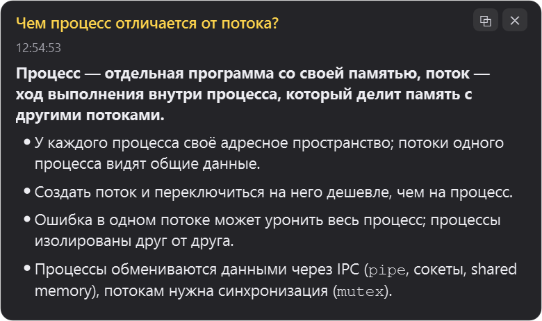
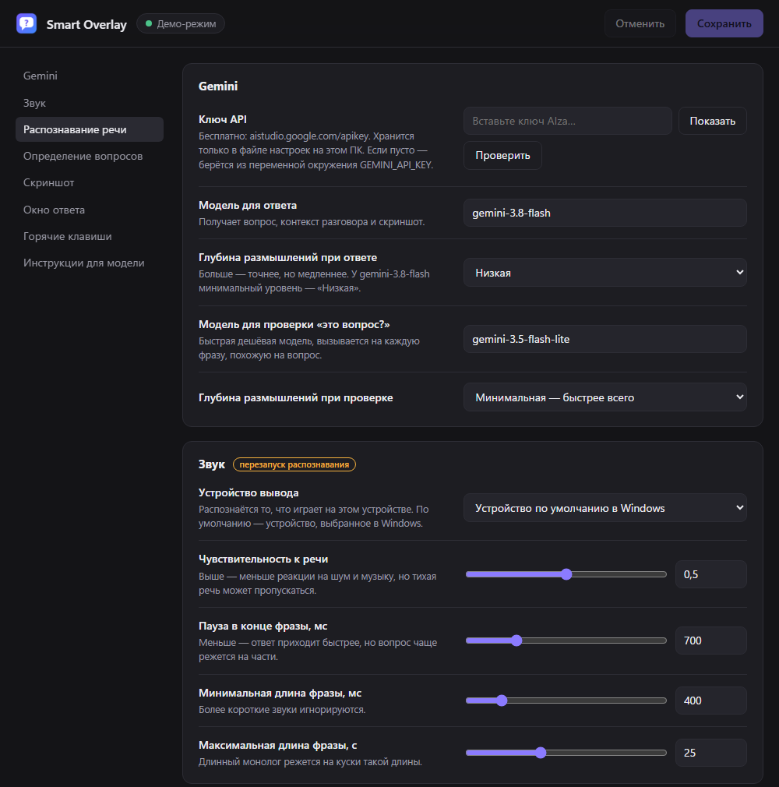
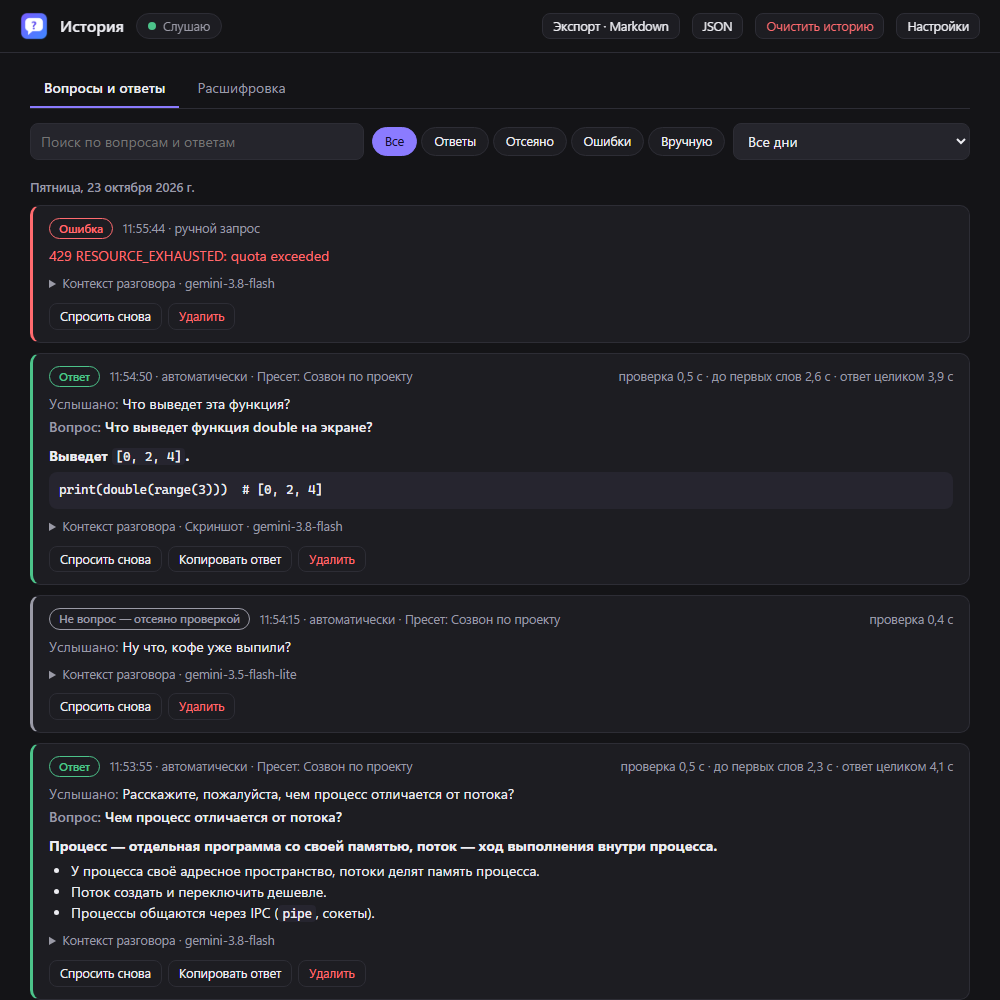

# Smart Overlay

Слушает звук, который играет на ПК (собеседник в созвоне, видео, лекция), распознаёт речь на видеокарте,
замечает вопросы и показывает ответ Gemini в полупрозрачном окне поверх всех окон. К вопросу прикладывается
скриншот экрана, так что можно спрашивать и про то, что на нём видно: код, задачу, таблицу.

*Windows app: listens to your PC audio, transcribes it locally with faster-whisper on the GPU, detects questions
and shows Gemini's answers (with a screenshot as context) in an always-on-top overlay. Interface in English,
Ukrainian and Russian.*

<p>
  
  
</p>

```
звук ПК (WASAPI loopback) → Silero VAD (фразы по паузам) → faster-whisper large-v3-turbo на GPU
  → «похоже на вопрос?» (быстрый фильтр) → «точно вопрос?» (Gemini Flash-Lite, с контекстом разговора)
  → скриншот → Gemini Flash (вопрос + контекст + пресет + скриншот) → ответ потоком в окно поверх экрана
```

## Установка

Нужны Windows 10/11, Python 3.11+ с [python.org](https://www.python.org/downloads/) и видеокарта NVIDIA.
Без видеокарты распознавание тоже работает, но на процессоре — медленнее.

1. Скачайте репозиторий (`git clone https://github.com/rostislav-kuparo/smart-overlay` или ZIP) в постоянную папку.
2. Запустите `install.bat`. Он создаст `.venv`, поставит зависимости (~2 ГБ вместе с cuBLAS)
   и добавит ярлык **Smart Overlay** в меню «Пуск». После этого программа находится через поиск Windows.
   `install.bat -Desktop` добавит ещё и ярлык на рабочий стол.
3. Запустите **Smart Overlay** из меню «Пуск». При первом запуске откроется окно настроек:
   вставьте ключ Gemini ([получить бесплатно](https://aistudio.google.com/apikey)), нажмите «Проверить» и «Сохранить».
   Модель Whisper (~1,6 ГБ) скачивается один раз при первом запуске.

Обновление: закройте программу (значок в трее → «Выход»), выполните `git pull` и снова `install.bat`.
Удаление ярлыков: `install.bat -Uninstall`.

## Как пользоваться

**Строка состояния** видна всё время: слушает ли программа, активный пресет и последняя распознанная фраза.
Прослушивание не останавливается, пока на экране висят ответы.

**Каждый ответ открывается в своём окне** и висит, пока вы его не закроете кнопкой ✕. Кнопка ⧉ копирует ответ.
Если пришло несколько ответов, окна открываются лесенкой, и ни один ответ не прерывает другой. Закрыть последнее окно —
`Ctrl+Alt+X`, все сразу — в трее. Окна не забирают фокус. Их можно перетаскивать мышью за любое место и растягивать
за края и углы, колёсико прокручивает ответ. Новые окна открываются там, куда вы перетащили последнее, и такого же
размера.

Строку состояния тоже можно двигать и растягивать. Если она должна пропускать клики сквозь себя, включите
«Пропускать клики сквозь строку состояния». Тогда двигать её можно в режиме «Двигать и растягивать» (`Ctrl+Alt+M`).

**Пресеты** — контекст задачи, который добавляется к каждому запросу: тема, ваша роль, стек, термины. С ним модель
быстрее понимает, о чём речь. Пресеты создаются в окне настроек. Переключать их можно в трее, на панели
«Управление» или клавишами `Ctrl+Alt+N`. Активный пресет виден в строке состояния окна ответа.

**Переключатели** работают сразу, без сохранения: в трее (правая кнопка мыши по значку) и на панели «Управление»
в окне настроек:

- слушать звук (пауза);
- отвечать автоматически (если выключить — только по `Ctrl+Alt+A`);
- прикладывать скриншот;
- проверять вопрос через Gemini;
- показывать окно, пропускать клики, двигать и растягивать окно.

**История** — всё, что заметил алгоритм, чтобы разбирать ошибки и возвращаться к ответам. Открывается кнопкой
«История» в окне настроек или из трея.

- **«Вопросы и ответы»** — каждое срабатывание детектора с итогом: ответ, «не вопрос» (отсеяно проверкой),
  повтор, ошибка или ответ прерван новым вопросом. У записи есть услышанная фраза, формулировка вопроса, ответ,
  пресет, время проверки и ответа, контекст разговора и скриншот. Есть поиск, фильтры и выбор дня.
  Кнопка «Спросить снова» повторяет запрос с тем же контекстом и скриншотом.
- **«Расшифровка»** — все распознанные фразы за день с отметками, где сработал детектор. Если программа
  пропустила вопрос, кнопка «Ответить на это» рядом с фразой задаёт его Gemini.
- **Экспорт** всей истории в Markdown или JSON и очистка в один клик.

История хранится только на этом ПК (`%APPDATA%\SmartOverlay\history.sqlite3`, скриншоты рядом в
`history_shots`). Записи старше 30 дней удаляются сами; срок, сохранение скриншотов и саму историю можно
выключить в разделе «История» настроек.



**Языки** (раздел «Язык» в настройках):

- интерфейс: русский, украинский, английский;
- язык речи для распознавания: русский, украинский, английский и другие;
- язык ответов Gemini: как в вопросе или любой заданный.

Двойной щелчок по значку в трее открывает настройки, повторный запуск из меню «Пуск» — тоже.

| Сочетание | Действие |
|---|---|
| `Ctrl+Alt+H` | показать / скрыть строку состояния |
| `Ctrl+Alt+A` | спросить вручную: скриншот + последние реплики |
| `Ctrl+Alt+X` | закрыть последнее окно ответа |
| `Ctrl+Alt+P` | пауза / продолжить прослушивание |
| `Ctrl+Alt+M` | двигать и растягивать строку состояния (когда включены сквозные клики) |
| `Ctrl+Alt+N` | следующий пресет |
| `Ctrl+Alt+↑` / `↓` | прокрутить последний ответ |
| `Ctrl+Alt+S` | открыть настройки |
| `Ctrl+Alt+Q` | выход |

## Настройки

Все параметры меняются в окне настроек и применяются сразу после сохранения. Изменения в разделах «Звук»,
«Распознавание речи» и языка речи перезагружают модель, это около 10 секунд. Настройки хранятся в
`%APPDATA%\SmartOverlay\config.toml`, журнал — в `%APPDATA%\SmartOverlay\smart_overlay.log`.

Что стоит знать:

- **Устройство вывода**: распознаётся звук, который играет на выбранном устройстве (по умолчанию — устройство
  Windows по умолчанию).
- **Проверять вопрос через Gemini**: если выключить, ответ придёт на ~0,5 с быстрее, но ложных срабатываний больше.
- **Окна ответов**: размер и место новых окон запоминаются, когда вы двигаете или растягиваете окно ответа.
  Высота 0 — окно растёт вместе с ответом.
- **Скрывать окно от захвата экрана**: окно не попадает на скриншоты, поэтому Gemini не видит собственные прошлые
  ответы. Побочный эффект: окно не видно и при записи или демонстрации экрана.
- **Инструкции для модели** можно переписать под себя.

Окно настроек — локальная веб-страница, открытая в Edge в режиме приложения. Сервер слушает только `127.0.0.1`,
а каждый запрос проверяется по случайному токену.

## Задержка

На RTX 3060 Ti фраза распознаётся за ~0,6 с. Дальше ~0,7 с ожидания паузы, ~0,5 с на проверку вопроса и 1–2 с
до первых слов от Gemini. Итого ответ начинает появляться через 2–4 с после конца вопроса.

## Что важно помнить

- Вместе с вопросом в Google уходят скриншот экрана, последние ~2 минуты расшифровки и текст активного пресета.
  Скриншоты отключаются переключателем.
- История (расшифровка, ответы, скриншоты) лежит на диске в открытом виде — не забудьте её очистить,
  если ПК общий.
- Программа слушает только системный звук, поэтому ваш микрофон в расшифровку не попадает.
- Платный тариф Gemini берёт деньги за каждый вопрос (проверка + ответ со скриншотом).
  У бесплатного тарифа есть лимиты на число запросов в минуту.

## Разработка

```
run.bat                 запуск с консолью и журналом на экране
run.bat --demo          окно с примером ответа, без звука и Gemini
run.bat --list-devices  устройства вывода звука
.venv\Scripts\python -m pip install -e .[dev] && .venv\Scripts\python -m pytest
```

```
smart_overlay/
  app.py              трей, горячие клавиши, переключатели, применение настроек на лету, один экземпляр
  pipeline.py         потоки: звук → фразы → текст → вопрос → Gemini
  audio.py            захват WASAPI loopback, Silero VAD, нарезка на фразы
  transcriber.py      faster-whisper на GPU, подключение cuBLAS из pip-пакета
  detector.py         быстрый фильтр «похоже на вопрос»
  gemini_client.py    проверка вопроса (JSON), потоковый ответ, пресет и язык ответа в инструкциях
  history.py          история: фразы, срабатывания детектора, ответы, скриншоты (SQLite), экспорт
  screenshot.py       снимок экрана → JPEG
  overlay.py          строка состояния и окна ответов: перетаскивание, растягивание, сквозные клики
  hotkeys.py          глобальные горячие клавиши (RegisterHotKey)
  config.py           схема настроек: значения по умолчанию, проверка, запись config.toml
  i18n.py             переводы интерфейса (ru / uk / en)
  settings_server.py  локальный сервер окна настроек
  web/settings.html   окно настроек
  web/history.html    окно истории
tools/make_icon.py    рисует значок
```
